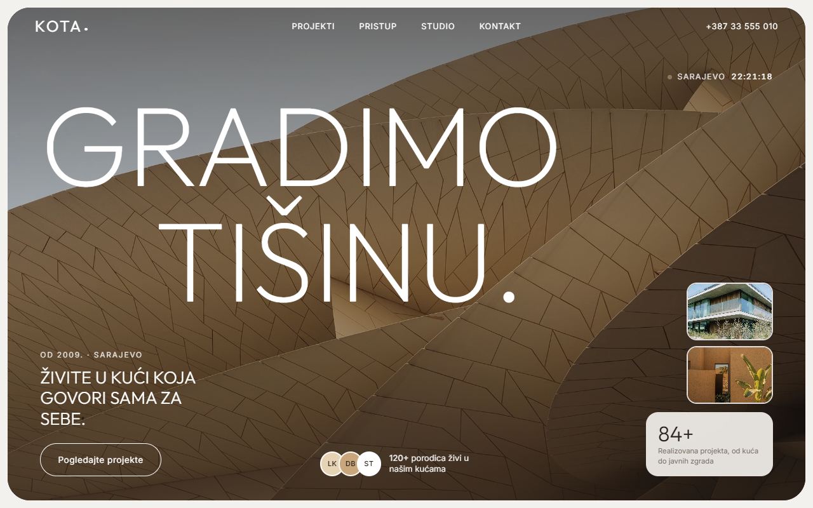
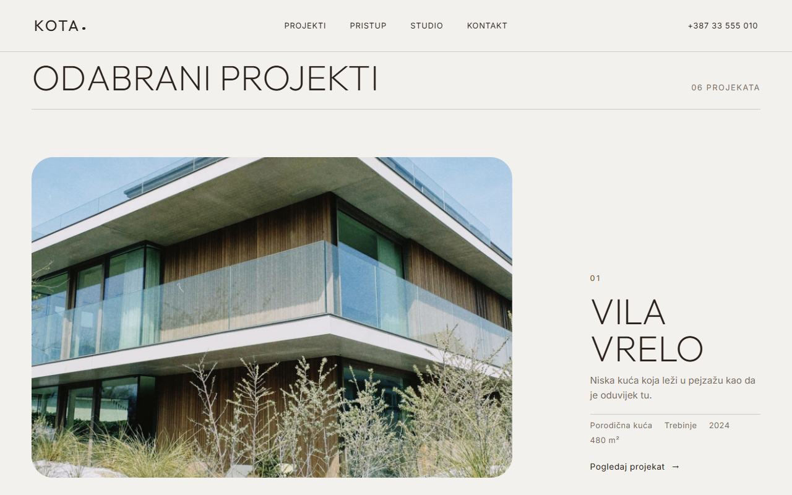
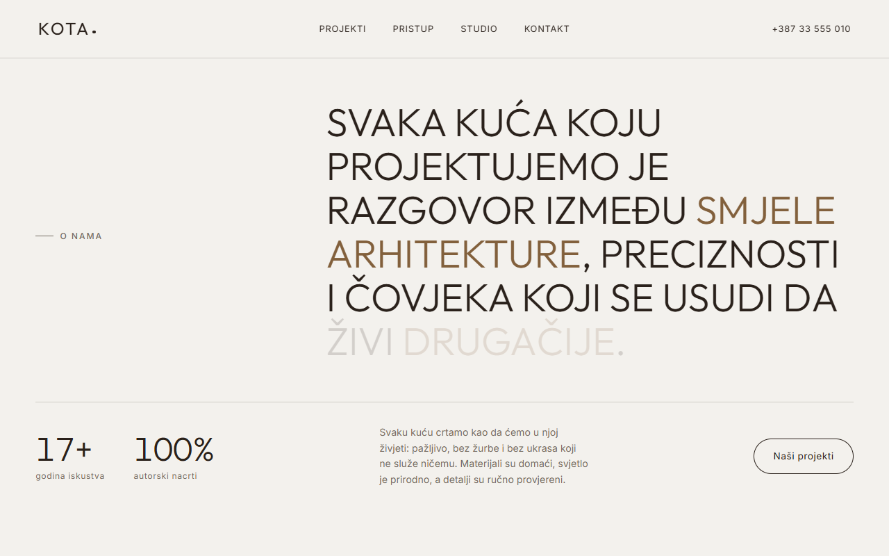
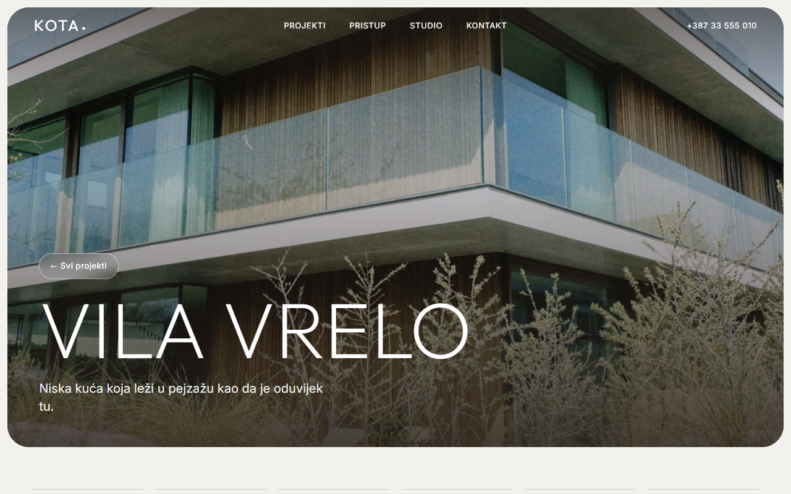
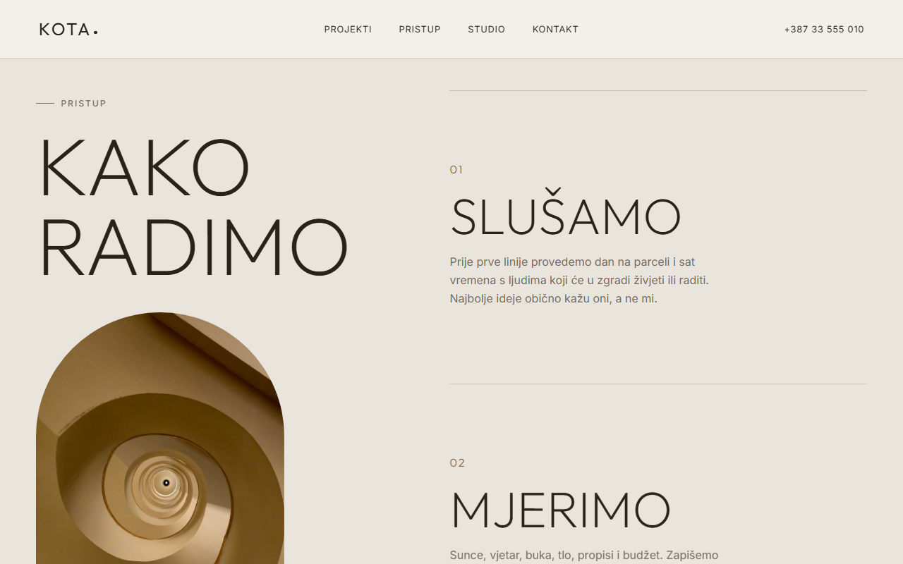
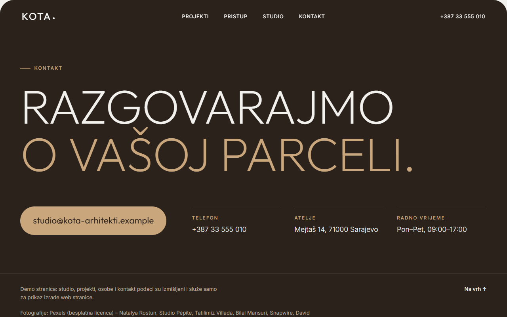
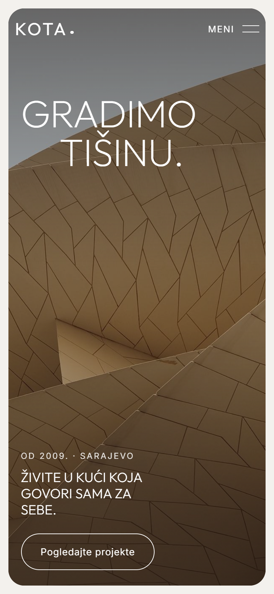
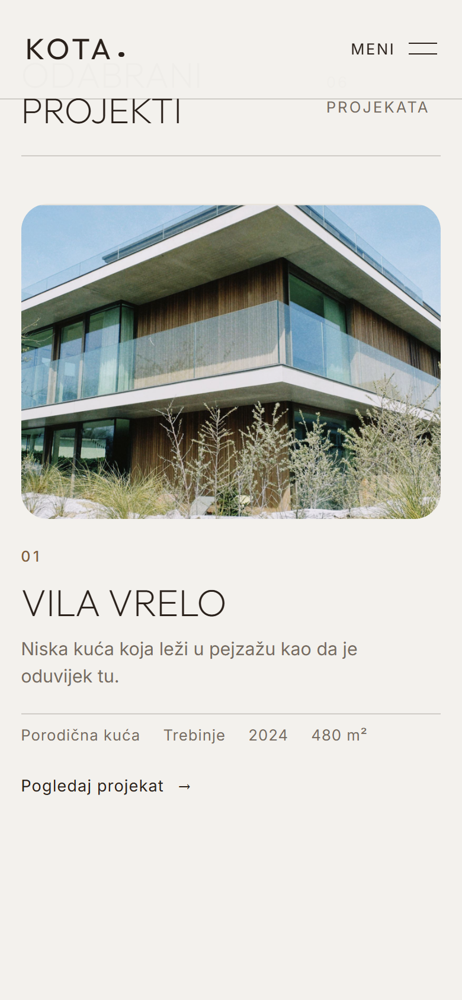

# Kota: architecture studio website

[](https://github.com/Emir0404/KotaStudio/actions/workflows/ci.yml)

A calm, elegant website for a (fictional) architecture studio in Sarajevo, built with ASP.NET Core 10 Razor Pages.
Sand and cocoa tones, thin capital headings, six project pages and a lot of white space. The rule behind every decision was
**elegance is calm**: no stacking cards, no heavy effects, nothing that jumps while you scroll.

**Live demo:** https://kota-arhitekti-demo.puskicemir.workers.dev (a static export served by Cloudflare Workers).
The site is in Bosnian; the code comments and this documentation are in English.

## Screenshots

 

 

 

  

## What is on the site

- **Hero** in a rounded frame: a large thin "GRADIMO TIŠINU." headline that rises out of a mask, two small pictures, a glass card, and a clock showing the time in Sarajevo.
- **About**: a long statement whose **words light up as you scroll**, two counters, and three interiors.
- **Projects**: six calm rows (a large photo and the facts beside it, alternating left and right; on a phone photo first, text after) and a
  **page per project** at `/projekti/{slug}`. The photo travels between the list and the project page with the browser's View Transitions.
- **Approach** (an arch with a photo and four steps), **studio** (the team as monograms, a quote) and **contact** on cocoa brown.
- A fixed header that is white over photos and dark over light sections, a full-screen menu on phones, and a "skip to content" link as the first Tab stop.
- Mouse-only extras: a round "Open" cursor over projects and buttons that move slightly towards the pointer.

## The interesting engineering

- **The content is data, and the data is tested.** Projects, spaces, numbers, steps, team and picture credits live in one C# class
  (`Data/Sadrzaj.cs`). The tests check it: every project has all its fields and a clean URL slug, every picture exists, has a recorded
  author and is not too heavy, the credits list has no unused pictures, "next project" loops through all projects without stopping, the years
  of work are computed from the founding year, and the contact data is clearly made up.
- **It works without JavaScript.** The server renders everything; the script only brings it to life, and the page is fully readable without it.
  `prefers-reduced-motion` switches the animations off, and a dark-mode phone keeps the page's own light look.
- **Reveal on scroll by position, not by `IntersectionObserver`**, because the observer skips elements on a fast scroll.
- **The statement is built in C#,** so that no stray space appears around punctuation when the words are split into spans.
- **No blur on the header:** a blur over photographs looks smudged, so the header is nearly opaque once you scroll.
- **Language quality is a test.** A test fails on words that are not Bosnian, on forms and bookings (the site is promotional only),
  and on informal "ti" forms: the studio addresses visitors with the formal "vi".
- **Static export for Cloudflare.** Workers cannot run ASP.NET Core and the site has nothing dynamic, so `Pripremi-objavu.ps1`
  runs the app, reads the page list from `/sitemap.xml` (home plus every project), saves each page as HTML (`projekti/<slug>.html`
  is served at `/projekti/<slug>`), copies `wwwroot` and writes `_headers`. The same 425 browser checks run against the export and the live address.
- **Plain extras done properly:** security headers, response compression, fingerprinted CSS and JS, `/robots.txt`, a sitemap with every project, a styled 404.
- **Photos:** Pexels only, no faces and no readable third-party brands. Two hero photographs show well-known buildings as atmosphere
  and the site never presents them as the studio's projects. See [IMAGE-CREDITS.md](IMAGE-CREDITS.md).

## Run it

Requires the [.NET 10 SDK](https://dotnet.microsoft.com/download). In Visual Studio press **F5**, or:

```bash
dotnet run --project src/Kota.Web      # http://localhost:5412
```

## Tests

```bash
dotnet test        # 44 tests
```

- **`SadrzajTests`**: projects, pictures and credits, numbers, steps, team and contact.
- **`TekstTests`**: the language and the "no forms, no bookings, formal address" rules.
- **`WebTests`**: the real app in memory: pages, project pages, 404, `robots.txt`, `sitemap.xml`, security headers, caching, fingerprinted CSS and JS, and the View Transitions names.

**Browser checks** (425, in a real browser through Playwright) cover an iPhone, a 360 px phone, a tablet, desktop, a 1920 px screen, a dark-mode phone,
no JavaScript, reduced motion, the menu, keyboard focus, all six project pages, the cursor, the counters, the statement, and rows that must never overlap.
They need Microsoft Edge (or set `BROWSER_CHANNEL=chrome`):

```bash
dotnet publish src/Kota.Web -c Release -o publish
cd publish && dotnet Kota.Web.dll --urls http://localhost:5411      # run it from the publish folder
# in a second terminal
cd tests/e2e && npm install && node e2e.mjs http://localhost:5411/ ./slike
```

CI builds the solution with warnings as errors and runs the C# tests; the browser checks are run locally.

## Static export and deploy

```powershell
powershell -File Pripremi-objavu.ps1          # writes ./cloudflare-site
cd cloudflare-deploy; npx wrangler deploy     # log in once with: npx wrangler login
```

To check the export before deploying: `node tests/e2e/server.mjs ./cloudflare-site 5413`, then run the browser checks against `http://localhost:5413/`.
Any ASP.NET hosting works too without the export: `dotnet publish` and run.

## Known limits (deliberate)

- A demo: the studio, projects, clients, people, quote and contact details are made up (the footer says so).
- Names of the content types and of CSS classes are Bosnian, and so are the descriptions printed by the browser checks.
  The site is a demo for the local market; comments and documentation are in English.
- No forms, bookings or database, by design; contact is an email address and a phone number.
- View Transitions between pages work in Chromium browsers; the others get an ordinary page change.

## Tech

C# · ASP.NET Core 10 Razor Pages · vanilla JavaScript and CSS (no framework) · xUnit · Playwright · Cloudflare Workers (static assets)
